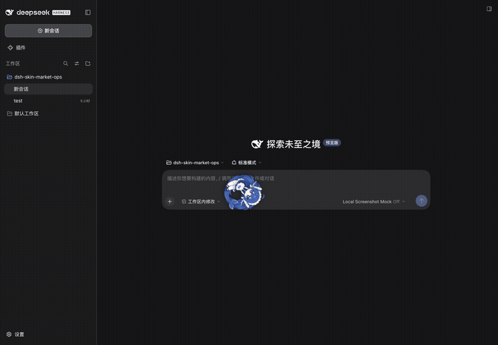

# dsh-think-bounce-pet

[📺 点击观看效果演示](https://www.bilibili.com/video/BV14d886GEx1)

DeepSeek Harness Web UI 的「思考弹球宠物」插件：让两只大肥鱼在界面里弹来弹去，无实意。


## 功能

- **常驻球**：插件开启期间一直在界面弹跳，不受思考状态影响。
- **思考球**：推理开始时从屏幕边缘飞入，思考结束后缩小消失。
- **交互**：点一下把球拍走，按住拖动再松手可扔出去。
- **鼠标碰撞**：开启后鼠标变成不可推动的障碍，球碰到会被弹开，且不能抓取。
- **重力**：可调 0（无重力）、1 倍、2 倍向下重力。
- **自定义**：初速度、碰撞损耗、摩擦力、球体大小都可实时调整。

## 设置

| 参数 | 默认 | 范围 | 说明 |
|---|---|---|---|
| 启用 | 开 | — | 关闭后移除常驻球与思考球，也不再随 think 生成球 |
| 鼠标碰撞 | 0（关） | 0–100 | 0=关闭；50=较大推力（400px/s）；100=50 的 5 倍推力；开启时鼠标为障碍且不能抓取球 |
| 重力 | 0（无） | 0–100 | 0=当前无重力；50=1 倍重力；100=2 倍重力 |
| 初速度 | 3440 px/s | 200–4000 | 发射、拍飞、扔出的初始速率 |
| 碰撞损耗 | 14 % | 0–90 | 每次碰壁损失的速度比例 |
| 摩擦力 | 0（无） | 0–100 | 指数阻尼强度（100 ≈ 每秒速度 ×0.018） |
| 球体大小 | 86 % | 20–200 | 以当前 144px 直径/72px 半径为 100% 基准，实时缩放视觉尺寸与碰撞箱 |

参数改动立即生效（飞行中的球下一帧就按新值计算），持久化在
localStorage 的 `dsh-think-bounce-pet.settings`；v0.1 的旧开关键会自动迁移。
最低速度固定为 46 px/s，不随以上设置项修改；重力模式下贴地时会额外保证竖直方向至少能弹起约 80px 高度，避免球贴地滚/抽搐。

## 安装 / 更新

```powershell
# 从 GitHub 安装
& '.\node_modules\.bin\dsh.cmd' plugin --profile web add github:9livewolf/dsh-think-bounce-pet

# 更新
& '.\node_modules\.bin\dsh.cmd' plugin --profile web update dsh-think-bounce-pet
```

客户端半边改动只需浏览器 F5；本插件无宿主侧逻辑，装好后重启一次 `dsh web`
即可长期生效。

## 结构

标准 DSH 双面插件：宿主半边 `lib/index.js` 为空壳（纯客户端 UI 插件）；
浏览器半边 `lib/client.js` 通过 `shell.overlay` 槽位挂载全屏
`pointer-events:none` 图层（每颗球各自一个图层，球本体 `pointer-events:auto`），通过
`settings.section` 槽位提供设置页。
